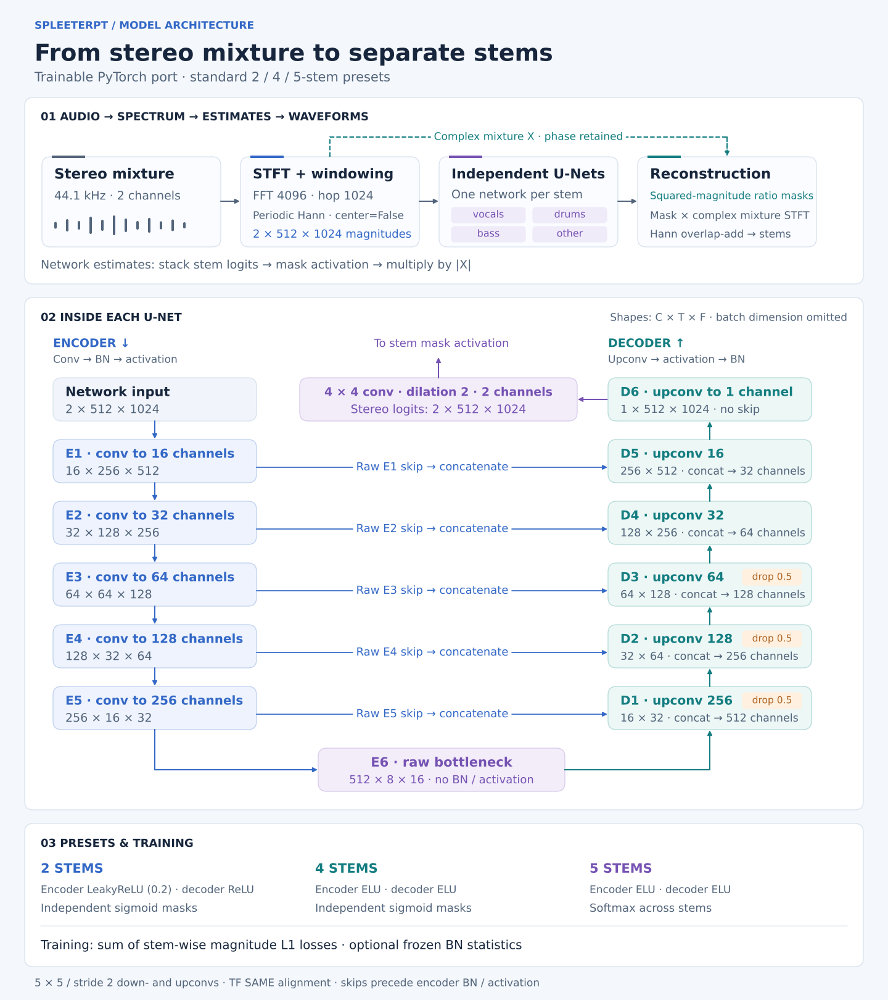
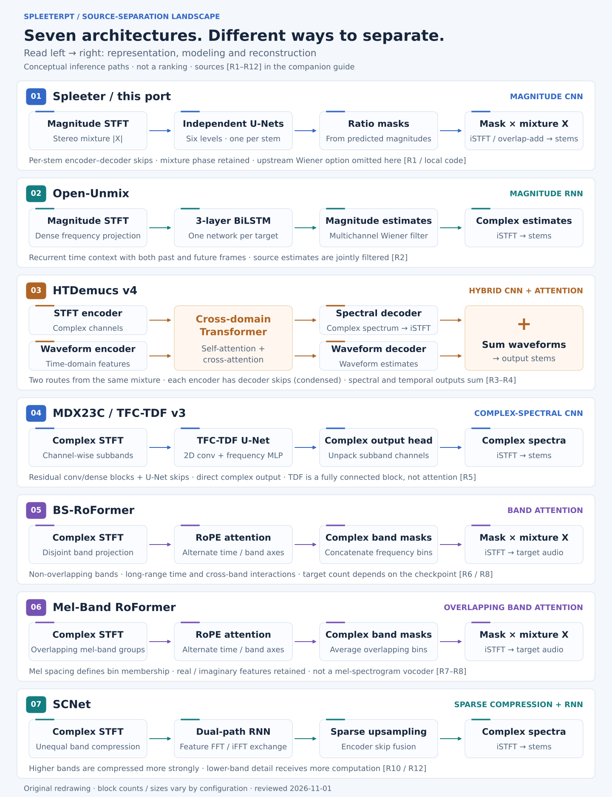

# spleeterpt

A trainable PyTorch port of [Deezer Spleeter](https://github.com/deezer/spleeter),
with official weight conversion, audio separation, and a single-GPU training entry
point for RunPod. This is an independent project, not an official Deezer release.

[Model architecture](#model-architecture) · [Alternatives](#spleeter-and-its-alternatives) ·
[When to use Spleeter](#where-spleeter-and-this-port-fit) · [Current progress](#current-progress--2026-11-01-sgt)

## Model architecture

[](docs/assets/model-architecture.svg)

The diagram shows the standard preset geometry, with four stems in the overview.
Each stem has its own U-Net and parameters. The networks estimate magnitudes;
inference derives squared-magnitude ratio masks and applies them to the original
complex mixture STFT before Hann overlap-add reconstruction.

[Architecture details and compatibility](#architecture-and-compatibility) ·
[Diagram source and regeneration](docs/architecture.md)

## Spleeter and its alternatives

Research reviewed **2026-11-01 (SGT)**. This is a practical selection of public
model families and widely integrated alternatives, not a market-share ranking.
**Competitors have not been benchmarked in this repository.** Architecture,
checkpoint, training data and inference settings all affect the result.

| Model family | Core architecture | Typical released targets | Choose it for | Main qualification |
|---|---|---|---|---|
| **Spleeter / spleeterpt** | Per-stem magnitude U-Nets | 2 / 4 / 5 stems | Existing Spleeter workflows, reproducible baseline, MIR preprocessing | Default modeled band ends near 11 kHz; mixture-phase reconstruction |
| **[Open-Unmix](https://github.com/sigsep/open-unmix-pytorch)** | Per-stem dense layers + 3-layer BiLSTM + Wiener filtering | 4 stems | Transparent recurrent reference; filtering research | `umx`, `umxhq`, `umxl` differ; default `umxl` weights are non-commercial |
| **[HTDemucs v4](https://github.com/facebookresearch/demucs)** | Waveform + spectrogram U-Nets with cross-domain Transformer | 4 stems; experimental 6-stem release | First practical four-stem challenger for remixing / editing | `htdemucs_ft` costs more passes; original repo archived, author fork has limited maintenance |
| **[MDX23C / TFC-TDF v3](https://github.com/kuielab/sdx23)** | Complex-spectral U-Net; 2D convolutions + frequency-wise dense blocks | Checkpoint-dependent: vocal or multi-stem | CNN alternative; UVR / MSST workflows | Model names cover different weights and ensembles; TDF is not a Transformer |
| **[BS-RoFormer](https://arxiv.org/abs/2309.02612)** | Non-overlapping bands; time / band RoPE attention; complex masks | Single-target or multi-stem, depending on weights | Quality-oriented separation; band-modeling research | Public community implementations are not the paper's exact training run |
| **[Mel-Band RoFormer](https://arxiv.org/abs/2310.01809)** | Overlapping mel bands + RoPE attention; overlapping masks averaged | Often vocals / instrumental; other targets need suitable weights | Vocal extraction / karaoke candidate | Vocal strength does not imply best bass or best four-stem average |
| **[SCNet](https://github.com/starrytong/SCNet)** | Unequal band compression + dual-path RNN + sparse decoder | Official four-stem release; other variants exist | Candidate for a quality / compute tradeoff | Paper CPU savings do not establish speed on our MIG GPU; base and large differ |

### Architecture comparison

[](docs/assets/separator-architectures.svg)

Original, simplified diagrams redrawn from papers and implementation code.
Arrows show inference data flow, not relative quality or model size. The Spleeter
row describes **this port's synthesis path**; upstream also offers Wiener filtering.
[Detailed comparison, paper results, source links and figure regeneration](docs/source-separation-landscape.md).

**Tools are a separate layer:** [UVR](https://github.com/Anjok07/ultimatevocalremovergui)
is a desktop application that hosts model families; [MSST](https://github.com/ZFTurbo/Music-Source-Separation-Training)
is a training/inference toolkit; [MVSep](https://mvsep.com/en/algorithms) is a hosted
service with model and ensemble choices. None is one architecture. Their exact
model selections and settings must be recorded for a meaningful comparison.

### Where Spleeter and this port fit

Spleeter's strongest case here is a **known, inspectable baseline** that can be
integrated into an existing workflow. Newer architectures are important quality
challengers; this project does not claim the best current separation quality.

| Need | Spleeter / spleeterpt advantage | Boundary |
|---|---|---|
| Maintain an existing Spleeter pipeline | Official weight conversion and checked 2/4-stem TF/PT waveform parity | Five-stem strict FP32 parity still has small discrepancies |
| Batch MIR preprocessing, rough stems, practice tracks | Ready 2/4/5-stem presets; local CLI and independent stem networks | Listen for bleed and artifacts; benchmark throughput on the actual workload |
| Study training, normalization or recovery | Inspectable CNN; checked resume/recovery; controlled BN experiments | The 90-step fine-tune has not improved on official weights |
| Keep inference in a PyTorch stack | TensorFlow needed only for checkpoint conversion | Local inference and trainability are also available in several alternatives |

For final vocal extraction, audition a pinned **Mel-Band / BS-RoFormer** checkpoint;
for a four-stem comparison, start with **HTDemucs**, then **SCNet** and a suitable
four-stem RoFormer setup. These are evaluation priorities, not measured winners.
Our default high-band truncation and mixture-phase masks are limitations for
full-band, high-fidelity deliverables. Fixed inference windows do not make this
implementation streaming: the full STFT remains in memory. No same-device claim
of fastest inference, lowest VRAM or lowest cost has been established.

The [comparison protocol](docs/source-separation-landscape.md#next-comparison-in-this-repository)
keeps the existing ten-song validation screen separate from a future final test.
The [Spleeter-4 / HTDemucs preparation](docs/spleeter4-htdemucs-protocol.md)
specifies the first controlled screen, resource checks, runtime compatibility
probe and budget. The [bounded benchmark workflow](.github/workflows/runpod-benchmark.yml)
runs isolated models with three full-song repeats, paired CPU scoring and compute
cleanup. It requires an explicit dispatch on `main`; no competitor music-quality
result is available yet.
The [first GPU trial](docs/spleeter4-htdemucs-protocol.md#first-gpu-trial-scoring-dependency-failure)
verified the 50 validation WAVs and both first-song GPU inference paths, then stopped
because scoring needed missing `ffmpeg/ffprobe`. Compute was deleted (about $0.0266
estimated); the correction checks scoring dependencies early and retains partial
measurements. The ten-song comparison has not completed.
The 2026-11-01 12:10 SGT read-only inventory found the existing Global Volume,
zero account Pods and MIG 24GB catalog capacity at $0.69/hour. The original regional
volume was not found; older regional-storage statements below are historical.

## Current progress — 2026-11-01 (SGT)

| Area | Verified status |
|---|---|
| PyTorch port | Trainable 2/4/5-stem U-Nets, official TF checkpoint conversion, separation, validation and resume |
| TF/PT parity | 2/4-stem real-audio waveform comparisons pass; 5-stem retains small FP32 numerical discrepancies under strict waveform tolerances |
| Legacy quality regression | Controlled ablations identified STFT frame alignment and, for 4 stems, activation mismatch; see [diagnosis](docs/audio-parity-and-legacy-diagnosis.md) |
| Real GPU training | Full 2/4-stem presets on RTX 4090, torch 2.8.0+cu128; training, validation, fresh-process resume and inference passed |
| Replacement-Pod recovery | Step 3 → new Pod → step 8; final/best state hashes and complete metrics match the continuous reference; actual checkpoint artifacts retained |
| Full training data | Official MUSDB18 AAC archive verified; 100 full songs (~6.35 h), project-specific 90/10 train/validation split; all 50 test songs untouched |
| Persistent training pilot | Passed: 80 GB persistent volume, all 500 audio hashes verified, step 10 → replacement Pod → step 90 / epoch 1, all ten validation songs; checkpoint generation every ten steps |
| Quality / convergence | Matched normal/frozen-BN 90-step trial complete on MIG with Global Volume: freezing avoids collapse but does not beat official weights consistently. Convergence and the full test benchmark remain unverified |

**Latest quality result:** The [matched frozen-BN pilot](docs/frozen-bn-41230412543.md) completed both 90-step arms and all ten full validation songs on PRO 6000 MIG 24GB. Freezing BN statistics avoids the ordinary-training collapse, but all four median paired changes versus official weights remain slightly negative: SDR −0.079/−0.074/−0.082/−0.096 dB and SI-SDR −0.035/−0.029/−0.023/−0.019 dB (vocals/drums/bass/other). Keep official converted weights as the inference baseline. [Aggregate results](docs/results/frozen-bn-41230412543.json).

**Earlier ordinary-BN result:** The step-90 fine-tune regresses substantially: all four stems score lower than official initialization on all ten validation songs, under both BSSEval-v4 SDR and global stereo SI-SDR. Do not promote this checkpoint as a quality improvement.

All ten complete validation songs (30.37 minutes), identical FP32
PyTorch inference. BSSEval-v4 SDR in dB:

| Stem | Official initialization | Step 90 | Median paired Δ | Better / worse |
|---|---:|---:|---:|---:|
| vocals | 7.446 | 1.055 | -6.387 | 0 / 10 |
| drums | 5.587 | 0.606 | -4.695 | 0 / 10 |
| bass | 4.645 | 0.726 | -3.534 | 0 / 10 |
| other | 4.382 | 1.506 | -3.856 | 0 / 10 |

Paired Δ is the median of within-song changes, not the difference of the two
aggregate medians. [Summary, SI-SDR, protocol and listening method](docs/step90-validation-41196010747.md),
[aggregate results](docs/results/step90-validation-41196010747.json),
and [successful GPU run](https://github.com/jasonjiang8866/spleeterpt/actions/runs/41196010747). The export contains 26 fixed listening WAVs;
all file hashes, lengths and audio samples were checked. No listening verdict is claimed.

**BN diagnosis:** The [four-cell GPU intervention](docs/bn-ablation-41221906972.md) completed on PRO 6000 MIG 24GB using a verified Global Volume snapshot. Restoring official BN running statistics recovers most of the step-90 quality loss; learned statistics alone reproduce the collapse. The subsequent matched training experiment confirms that using fixed official BN statistics avoids this pilot’s large regression; it does not establish superior weights or fully explain why ordinary training produced the damaging statistics.

Evidence: [real GPU training](https://github.com/jasonjiang8866/spleeterpt/actions/runs/41179746234),
[replacement-Pod recovery](https://github.com/jasonjiang8866/spleeterpt/actions/runs/41187527968),
[persistent pilot continuation](https://github.com/jasonjiang8866/spleeterpt/actions/runs/41191613855),
[full-data provenance](docs/results/musdb18-training-provenance.json), and
[persistent-pilot evidence](docs/results/persistent-pilot-41189465452.json).
Recovery artifacts expire on **2026-11-14**; both test Pods were deleted.
Decoded data is now checksum-verified on RunPod volume `j3aqjpw393` (EU-RO-1),
mounted at `/data/musdb18`. The retained 80 GB STANDARD volume costs approximately
**$5.60/month** even when no Pod runs. See the [persistent pilot run](https://github.com/jasonjiang8866/spleeterpt/actions/runs/41189465452). No pretrained weights or
training audio are bundled in this repository.

The persistent pilot used **one crop per song**, not every sample of the full
recordings. It retained the original ten metrics exactly, then completed 90 total
training updates and ten-song validation (spectral loss **6.99237**, not SDR and
not evidence of improvement). `last.pt` and `best.pt` are retained under
`/data/experiments/41189465452-1/backups`; only reports are in the new Actions
artifacts. All three compute Pods were deleted. Logged GPU compute is estimated
at **$0.47** for preparation, interrupted training and continuation, excluding
storage/Actions charges. The original run exposed a tuple/list acceptance bug
**after** saving step 10; the fix and successful continuation are recorded in
[PR #10](https://github.com/jasonjiang8866/spleeterpt/pull/10).

## Install

Use Python 3.10–3.12 and a PyTorch build appropriate for your CPU/GPU. The tested
CPU CI baseline is PyTorch 2.6.0 on Python 3.10/3.12. The real-music RunPod
training/recovery baseline is PyTorch 2.8.0+cu128 in FP32; those results do not
establish equivalent quality or reproducibility for AMP.

```bash
git clone https://github.com/jasonjiang8866/spleeterpt.git
cd spleeterpt
python -m venv .venv
source .venv/bin/activate
# CPU example. On RunPod keep/install the CUDA-enabled PyTorch build instead.
python -m pip install torch==2.6.0 --index-url https://download.pytorch.org/whl/cpu
python -m pip install -e '.[dev]'
python scripts/smoke_test.py
```

The smoke test uses small synthetic audio and temporary files. It checks training,
validation, resume, checkpoint reload, and WAV inference; it does not assess music
separation quality. Runtime training/inference needs no TensorFlow.

## Convert official pretrained weights

Conversion uses TensorFlow **once**, to read the original TF1 checkpoint. You can
do this in a separate environment and copy the resulting `.pt` file to RunPod.
Only the official name-based checkpoint layout is supported; unknown model tensors
or shape mismatches are rejected. Converted files retain source SHA-256 hashes.

```bash
python -m pip install -e '.[convert]'
mkdir -p weights/2stems
curl -fL https://github.com/deezer/spleeter/releases/download/v1.4.0/2stems.tar.gz -o /tmp/2stems.tar.gz
tar -xzf /tmp/2stems.tar.gz -C weights/2stems
spleeterpt convert --checkpoint weights/2stems/model --stems 2 --output weights/2stems.pt
spleeterpt separate song.wav --checkpoint weights/2stems.pt --output outputs/song --device cpu
```

For 4/5 stems, use the corresponding official `4stems.tar.gz` / `5stems.tar.gz`
archive and matching `--stems`. Inference accepts audio formats supported by
libsndfile, duplicates mono to stereo, and resamples to the checkpoint sample rate.
Output is stereo float WAV at that rate, avoiding silent PCM clipping. Network
inference uses fixed windows; the full STFT still resides in memory.

## Prepare training data

Use aligned **44.1 kHz stereo WAV** files with exactly the same sample count per
track. The loader rejects misalignment and wrong sample rates rather than silently
resampling stems independently. Expected files under each `data/train-pool/<track>`:

- `mixture.wav`, `vocals.wav`, `drums.wav`, `bass.wav`, `other.wav`.
- For 2 stems, `accompaniment.wav` is used when present; otherwise drums + bass +
  other are summed.
- For 5 stems, provide `piano.wav`, with `other.wav` excluding piano. Standard
  MUSDB four-stem data cannot provide a supervised five-stem target on its own.

Split the **training pool** by song; keep a separate test set untouched:

```bash
spleeterpt manifest --root data/train-pool --output data/manifests --validation-tracks 10 --seed 0
```

Or supply your own train/validation JSONL manifests. Each line is
`{"track": "/absolute/path/to/track"}`; relative paths resolve against the manifest
directory. Overlapping train/validation directories are rejected. Equivalent songs
copied to different directories still require manual duplicate checking. Manifest
generation refuses to overwrite an existing split.

For the checksum-verified complete MUSDB18 preparation command and recorded
90/10 split (seed 17), see [full-data preparation](runpod/recovery.md#complete-training-data-preparation).
The generic manifest example above creates a different split; do not mix it with
that recorded experiment.

## Train or fine-tune

```bash
spleeterpt train \
  --config configs/2stems.json \
  --train-manifest data/manifests/train.jsonl \
  --val-manifest data/manifests/validation.jsonl \
  --output runs/2stems-baseline \
  --device cuda --precision fp32 --batch-size 1 --epochs 100
```

This starts from random initialization. Add `--init weights/2stems.pt` to fine-tune
converted weights with a fresh optimizer. Use `configs/4stems.json` or
`configs/5stems.json` for the other model presets.

- Loss: sum of per-stem mean absolute magnitude-spectrogram errors.
- Optimizer: Adam, learning rate `1e-4`, gradient norm clipping at `5` by default.
- Training crops: 16 per track per epoch, deterministic from seed/epoch/index.
- Validation: 4 fixed, evenly spaced crops per track; logged each completed epoch.
- Precision: `fp32` baseline; `fp16` uses GradScaler; `bf16` requires GPU support.
- Checkpoints: `last.pt` every 150 batches and at epoch end; `best.pt` after improved
  validation. Config, optimizer, scaler, position, and Torch RNG states are saved.
- Optional `--backup-dir /data/experiment/backups`: publish a checksum-verified
  generation at every `last.pt` save, including matching metrics and `best.pt`
  when available. Retains the latest three committed generations. Mount persistent
  storage there; an ordinary local directory does not survive Pod deletion.
- Logs: stdout + `metrics.jsonl`; settings in `config.json` and `arguments.json`.
- `--max-steps N` limits **total batches**, including resumed batches. An early exit
  saves `last.pt` but may precede validation, so `best.pt` may not exist yet.

Resume with the same data, seed, batch/crop/precision/optimizer settings and add:

```bash
--resume runs/2stems-baseline/last.pt
```

`--epochs` is the desired total epoch count, not additional epochs. Resume verifies
resolved data paths and file size/mtime metadata. If data moved or settings changed,
start a new output directory with `--init` instead. Only `.pt` files created by this
project are accepted; an official TF checkpoint first needs `convert`.

## Architecture and compatibility

| Property | Implementation |
|---|---|
| Spectrogram | Periodic Hann, FFT 4096, hop 1024, 44.1 kHz |
| Network window | 512 time frames × 1024 frequency bins, stereo |
| U-Net | One per stem; channels 16, 32, 64, 128, 256, 512 |
| Down/up blocks | 5×5 stride-two convolutions; TF SAME spatial alignment |
| Skip connections | Raw encoder convolution outputs, including raw bottleneck |
| Decoder | Activation → BN; ordinary dropout 0.5 in first three blocks |
| Output | 4×4 convolution, dilation 2; two stereo channels |
| 2 stems | LeakyReLU encoder, ReLU decoder, sigmoid masks |
| 4 stems | ELU encoder/decoder, sigmoid masks |
| 5 stems | ELU encoder/decoder, softmax across stems |
| Synthesis | Squared magnitude ratio masks and upstream Hann overlap-add |

Encoder skips branch before BN and activation; the sixth raw convolution is the
bottleneck. Decoder dropout is applied after BN and before concatenation in its
first three blocks. The final decoder produces one feature channel, then a
dilated convolution produces two stereo logits per stem. Five-stem softmax is
applied **after** stacking logits from all five independent U-Nets.

Training compares the predicted magnitudes with target magnitudes using summed
per-stem L1 losses. `--freeze-bn-stats` uses fixed BN moments while continuing to
train BN affine parameters and keeping dropout active; see the
[matched pilot](docs/frozen-bn-41230412543.md) for measured results.

The default `mask_extension="zeros"` matches upstream and drops frequencies above
the modeled band (about 11 kHz). `average` extends masks to higher frequencies and
preserves the mixture sum, but changes the upstream default behavior.

Training is a practical port, not an identical reproduction of Deezer's original
training run: data/crops, RNG/initialization, BN running-variance updates, Adam
details, and gradient clipping can differ. The original dataset, spectrogram cache
quantization, optional augmentation, multichannel Wiener filtering, and distributed
training are not reproduced. Quality must be measured on held-out music.

## Verification

```bash
pytest -q
ruff check .
ruff format --check .
# Optional TF numerical oracle (skipped when TensorFlow is absent):
pytest -q tests/test_tensorflow_parity.py
# Compare with the ORIGINAL official serialized inference graph:
python scripts/verify_official_checkpoint.py \
  --tf-checkpoint weights/2stems/model --checkpoint weights/2stems.pt
```

See [validation notes](docs/validation.md), [RunPod instructions](runpod/README.md),
and the [persistent training pilot](runpod/persistent.md).

New: [real-audio parity and legacy-port diagnosis](docs/audio-parity-and-legacy-diagnosis.md)
includes complete TF/Torch waveform comparisons, controlled legacy ablations, and
a five-track ground-truth MUSDB preview check. Two/four stems match; the stricter
five-stem waveform test retains a small numerical discrepancy and is not marked passed.

## Attribution

Ported against upstream commit
[`c8854001ac8acad34a9bc2bd15f28475541828b1`](https://github.com/deezer/spleeter/tree/c8854001ac8acad34a9bc2bd15f28475541828b1).
See [third-party notices](THIRD_PARTY_NOTICES.md) and [LICENSE](LICENSE).

### Full MUSDB port-quality evaluation

For a reproducible four-way comparison of official TensorFlow, current spleeterpt,
original legacy PyTorch and corrected legacy PyTorch on locally supplied MUSDB18
or MUSDB18-HQ, see [the evaluation guide](docs/musdb-evaluation.md).
The entry point supports full selected subsets, deterministic samples, BSSEval-v4
SDR and separate global stereo SI-SDR, per-song records and integrity validation.
Only 2/4-stem targets are supported. The full four-way port comparison has not yet been run. The separate ten-song
official-initialization vs step-90 result is recorded above.
