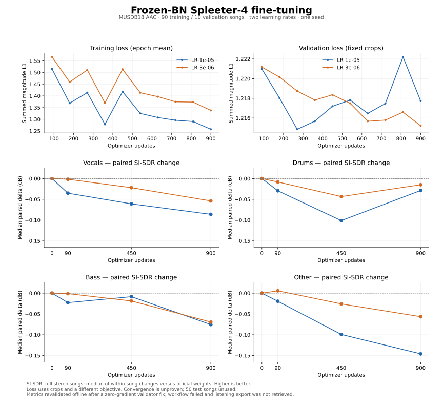

# Longer frozen-BN training: no stable gain over official weights

Measured 2026-11-01 (SGT), source commit
[`7c47e4b6c416c758e6bb3d0549a783b090553d02`](https://github.com/jasonjiang8866/spleeterpt/commit/7c47e4b6c416c758e6bb3d0549a783b090553d02).
[Run 41290811204](https://github.com/jasonjiang8866/spleeterpt/actions/runs/41290811204)
**ended with a failed workflow status because of a post-run validator bug**.
Both 900-step arms and all quality measurements completed. The retained report
passes an independent offline audit after correcting the finite-zero rule below.
The original failed status is preserved; the missing listening export is not
represented as delivered or verified.

**Keep converted official weights as the baseline.** Both learning rates have
negative median paired SDR and SI-SDR changes on every stem at step 900. This
extends training beyond the earlier 90-step pilot and verifies the training /
Global recovery / measurement loop, but establishes neither improved weights
nor convergence. No additional paid attempt was launched.

[Predeclared protocol](convergence-pilot-protocol.md) ·
[Machine-readable summary](results/convergence-pilot-41290811204.json) ·
[Independent audit](results/convergence-audit-41290811204.json)

## Quality on ten complete validation songs

MUSDB18 **AAC**, not HQ; 90 training / 10 validation songs, with all 50 test songs
unused. The ten validation recordings total 30.37 minutes and have been used in
previous screening. Upstream pretrained-data overlap remains unresolved. One seed
and a reused small validation set do not support an unbiased leaderboard or a
statistical superiority claim.

The following changes are **medians of within-song candidate-minus-official
changes**, not differences between independently aggregated medians.

| Stem | SDR Δ, LR 1e-5 | SDR Δ, LR 3e-6 | SI-SDR Δ, LR 1e-5 | SI-SDR Δ, LR 3e-6 |
|---|---:|---:|---:|---:|
| vocals | −0.087 | −0.095 | −0.086 | −0.054 |
| drums | −0.124 | −0.035 | −0.029 | −0.015 |
| bass | −0.159 | −0.183 | −0.076 | −0.069 |
| other | −0.089 | −0.053 | −0.146 | −0.057 |

Individual songs sometimes improve: SDR better/worse counts are 3/7, 4/6, 3/7,
4/6 at LR 1e-5, and 2/8, 4/6, 3/7, 3/7 at LR 3e-6 (stem order above). Do not
interpret the negative paired medians as every individual song worsening.
The JSON also retains absolute medians, per-track values, frame coverage and
common-finite-frame SDR. Some absolute aggregate medians increase even though
paired medians decrease; they answer different questions.

The official baseline passes the predeclared 0.001 dB mean/median reproduction
gate with unchanged coverage. All seven SI-SDR measurements (official and three
milestones per arm) cover all ten full songs with finite values.

## Training and quality curves



Both arms use official initialization, frozen BN running buffers, trainable BN
affine parameters and active training dropout. Adam, FP32, seed 17, clip norm 5,
TF32 off and deterministic training were held fixed. Each arm completed 900
optimizer steps and ten epoch validations, with no skipped updates. Model
parameters stayed finite; running buffers stayed unchanged; affine and other
parameters changed. Final RNG states and data/recipe signatures (except LR)
match between arms.

| Measurement | LR 1e-5 | LR 3e-6 |
|---|---:|---:|
| Epoch-1 → epoch-10 mean training loss | 1.515146 → 1.257189 | 1.566567 → 1.337793 |
| Epoch-1 → epoch-10 validation loss | 1.220972 → 1.217726 | 1.221168 → 1.215214 |
| Lowest crop validation loss | 1.214855 at step 270 | 1.215214 at step 900 |
| Training phases, seconds | 153.644 | 155.707 |
| Peak allocated training CUDA GiB | 1.041 | 1.041 |

Training loss uses changing crops, so epoch means are not a fixed-example
learning curve. Validation loss uses four fixed crops per song; it is not directly
comparable with the earlier one-crop pilot. Its small decrease does not imply
better waveform separation. The step-270 loss minimum was not a predeclared full-
song quality endpoint and is not promoted or claimed superior.

One crop per training song per epoch yields 900 excerpts per arm. Their union
covers **354,219,654 / 928,198,656 training-pool samples (38.16%)**, about 2.23 hours
of unique audio; repetitions total about 2.99 hours. This is not ten complete
passes over every recording sample. Exact crop offsets are retained in the JSON.

## Validator failure and evidence recovery

Both arms recorded `loss=0.0`, `grad_norm=0.0`, `update_skipped=false` at step 598
(epoch index 6). Every step and epoch record is present; no nonfinite loss was
found. The new acceptance code incorrectly required **strictly positive** loss
and gradient norm, although a finite zero is legitimate. A real silent-crop CPU
training regression test reproduces zero loss/norm while Adam still advances its
step counter. This establishes the rule error; the exact real-music crop has not
been re-read locally, so silence is not asserted as its verified cause.

The fix accepts finite **nonnegative** loss/norm, still rejects negative values,
NaN/infinity, skipped updates and incomplete history, and additionally checks
training epoch/step alignment. A separate retained-report audit does not turn a
failed worker envelope into a passed one. All predeclared quality gates remain
unchanged, including baseline reproduction, complete song selection, lengths,
stems, SI-SDR and frame coverage.

The worker had already written the full report and a 102,318,080-byte listening
archive before its final validation failed. The old controller validated before
downloading, and the worker served exports only for a passed status. Consequently,
**the archive was not retrieved before compute cleanup**. Its descriptor remains
in the report, but its bytes and the 34 clips have not been independently verified
or delivered. The report package contains metrics/curves/audit, not audio.

The controller now downloads and hash-validates a declared bounded completed
export before acceptance, including failed terminal states. Authentication,
fixed-file access, chunk bounds and the 100 MiB download limit remain enforced;
running workers cannot expose an unfinished archive. Offline HTTP/controller
regression tests cover failed-state export retention and compute cleanup. This
prevents the same evidence-loss ordering on future runs; it does not recover the
already-deleted archive or change this run's failure status.

## Storage, time and cost

The existing Global Volume supplied the verified 503-file snapshot (500 WAVs and
three metadata files). No regional volume was created. Six complete milestone
exports occupy **2,831,181,828 bytes (~2.637 GiB)** under:

`/global/convergence-runs/41290811204-1/{lr1e5,lr3e6}/{90,450,900}/`

Each export includes the full `last.pt` training state, config, arguments,
cumulative metrics, timing and completion marker. At steps 90 and 450, each arm
read the published checkpoint into a fresh local directory, checked full-state
equality and resumed it in a new Python process. This is process/Global recovery,
not a new replacement-Pod test. Local `best.pt` was not promised as durable.

One PRO 6000 Blackwell MIG 1g.24gb at **$0.69/hour**, 41.63 minutes controller
wall-clock, **$0.478765 estimated compute**. Pod `cicz0ovd3f19gw` was deleted and
its disappearance confirmed; the workflow's final cleanup found zero managed
Pods to delete. Storage/request charges are additional and this estimate is not
an invoice.

The two training phase totals sum to 309.35 seconds (5.16 minutes), including
crop validation and local checkpoint writes. The three full quality passes sum
to 1,545.54 seconds (25.76 minutes), including inference and CPU BSSEval. Other
time includes environment setup, data staging/hashing, exports and short SI-SDR
passes. These are experiment phase timings, not isolated inference benchmarks.

Raw Actions artifact: `13078856191`, 833,710 bytes, SHA-256
`82c0dfdb6e1da1d0537328c0e604fbddd398da55dde3bf7ff30063055fbaba6a`.
It contains the unchanged failed worker result and cleanup/provision record;
retention expires 2026-11-15. The downloadable report package also retains these
records and the offline audit. Checkpoint files stay on Global Volume.

## Next decision

The follow-up [offline loss/quality audit](loss-quality-audit-41290811204.md)
pairs checkpoint transitions by song and reproduces a magnitude-loss/reconstruction
counterexample on CPU. It recommends matched-crop measurements with existing
checkpoints before any additional training; the real-music cause remains open.

Do not simply extend this recipe or replace the official baseline. First inspect
the relationship between the magnitude training objective and reconstructed-
audio quality, and review the identified zero-loss crop. Treat objective mismatch,
data coverage and overfitting as hypotheses to test, not causes established by
this experiment. Keep the same validation split for diagnosis and leave the test
pool unused until a recipe is frozen.

Recreate the report and figure with Matplotlib 3.10.8 from the retained JSON:

```bash
python scripts/report_convergence.py \
  --result path/to/result.json --provision path/to/provision.json \
  --output docs/results/convergence-pilot-41290811204.json \
  --figure docs/assets/convergence-pilot-41290811204.svg
```
